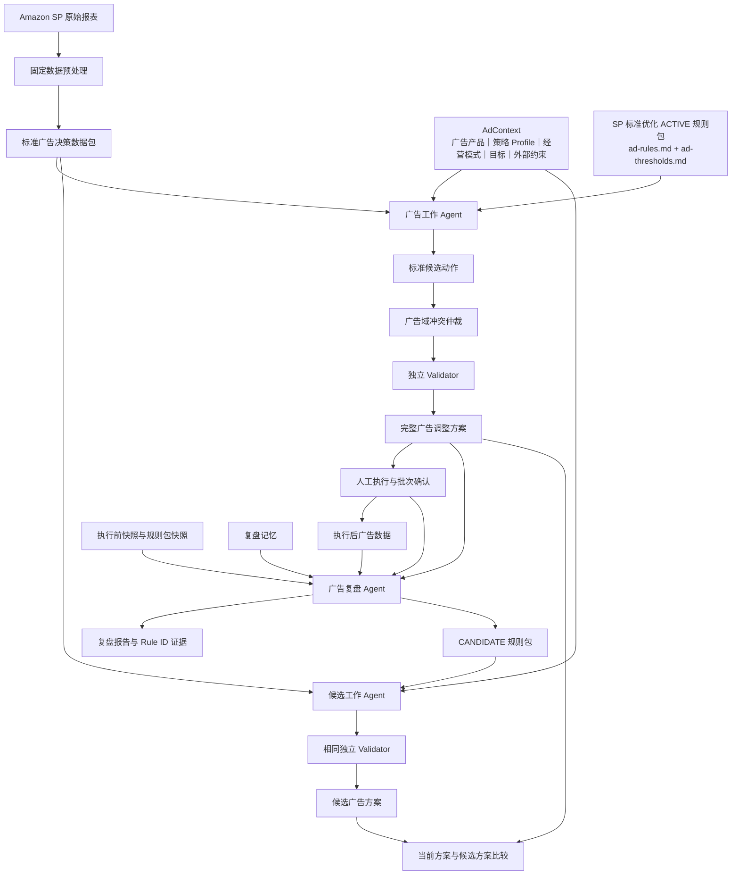
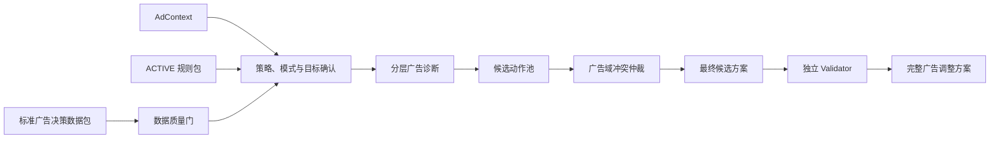
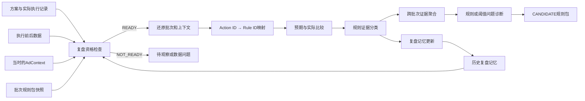
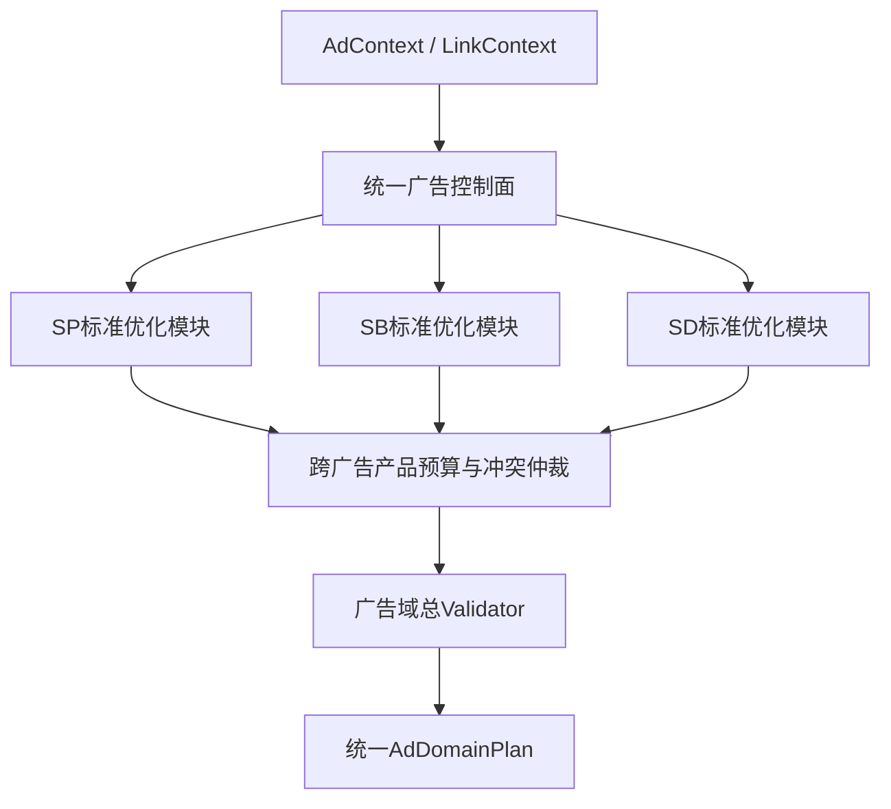
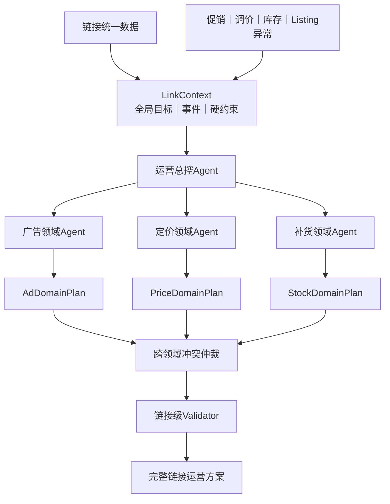

# AI 广告 Agent 完整架构与实施方案

> 文档定位：AI 广告 Agent 团队讨论、开发与分阶段实施依据  
> 当前实施范围：优先跑通 SP 标准广告优化、方案生成、独立验证和规则复盘  
> 后置扩展：SP 冷启动、多类目、SB/SD 标准优化及链接级 AI 运营  
> 核心原则：确定性计算与 AI 决策分离、工作与复盘分离、规则与阈值分离、ACTIVE 与 CANDIDATE 分离

---

# 一、广告 Agent 方案摘要

## 1. 总体定位

AI 广告系统由以下模块组成：

1. **广告工作 Agent**：读取正式规则包和标准广告数据，对广告进行诊断、生成候选动作、处理广告域内冲突，输出完整广告调整方案。
2. **独立 Validator**：检查数据权限、规则版本、对象映射、动作冲突和风险，不新增或修改动作。
3. **广告复盘 Agent**：根据实际执行和执行前后数据评价规则表现，沉淀 Rule ID 证据并生成 CANDIDATE 规则包。
4. **候选工作 Agent**：使用 CANDIDATE 规则包重新生成完整候选方案，与当前方案进行同源比较。

广告执行不属于 Agent 职责。当前阶段由人工执行，并记录实际执行值和执行时间。

当前正式方案和候选方案分别由配置相同的两个工作 Agent 生成：

```text
当前工作 Agent
→ 读取 ACTIVE 规则包
→ 生成当前方案

候选工作 Agent
→ 读取 CANDIDATE 规则包
→ 生成候选方案
```

两者之间只允许规则包不同，模型、提示词、生成参数、数据快照、AdContext、输出 Schema 和 Validator 必须相同。

当前实施对象是：

```text
SP_STANDARD_OPTIMIZATION
```

它表示“SP 标准广告优化”，不是永久限定于老品的规则。首版主要使用成熟 SP 广告对象完成开发和历史回放，但广告 Agent 不判断新品或老品，具体使用哪套策略由外部系统明确提供。

SP 冷启动作为后期独立策略接入，只负责从0到1创建初始 SP 广告结构。冷启动实际执行7天后，进入 SP 标准优化。SB 和 SD 不设计冷启动模板。

## 2. 当前阶段总体架构



## 3. 模块职责边界

| 模块 | 核心职责 | 明确不负责 |
|---|---|---|
| 数据预处理程序 | 清洗、计算、汇总、映射、对账和冻结数据快照 | 不判断广告动作和规则命中结果 |
| 广告工作 Agent | 广告诊断、候选动作、冲突仲裁和完整方案生成 | 不执行广告、不复盘、不修改规则 |
| 独立 Validator | 检查数据、对象、版本、冲突和风险 | 不新增或修改动作 |
| 广告复盘 Agent | 评价规则、沉淀证据、生成 CANDIDATE 规则包 | 不生成当前方案、不覆盖 ACTIVE |
| 候选工作 Agent | 使用 CANDIDATE 生成完整候选方案 | 不自行修改候选规则 |
| 人工执行 | 按方案执行并确认实际结果 | 不替代规则复盘 |

## 4. 关键设计原则

1. 确定性指标、阈值解析、格式检查和 Validator 由固定程序执行。
2. Agent 只读取结构化输入并输出结构化结果，不直接处理全部原始报表。
3. 所有可调整数值只保存在阈值文件或参数文件中。
4. 生产工作 Agent 只读取 ACTIVE；候选工作 Agent 只读取指定 CANDIDATE。
5. 复盘 Agent 只能生成 CANDIDATE，不能覆盖或激活 ACTIVE。
6. 每个动作必须能够追溯到数据快照、规则、阈值、上下文和版本。
7. 同一广告实体、同一批次只保留一个主动作。
8. 正常、活动和异常数据分别判断，活动数据不得覆盖正常经营基线。
9. 广告 Agent 不判断新品和老品，只读取外部指定的 StrategyProfile。
10. 不支持的广告产品或 StrategyProfile 必须明确阻断，不得隐式回退。
11. 第一阶段采用文件化管理和人工执行，不接数据库和自动执行器。
12. 当前规则驱动 MVP 后续可以升级为概率型 Predict-then-Optimize，但公共数据合同保持兼容。

---

# 二、广告工作 Agent 的核心架构和逻辑

## 1. 工作 Agent 核心架构



## 2. 工作 Agent 输入

工作 Agent 只读取经过预处理的标准决策数据包。

固定输入包括：

- `ad_decision_packet.xlsx`或同结构 JSON；
- 当前 ACTIVE 规则包；
- AdContext；
- 必要时按对象 ID 回查的证据明细。

标准决策数据包至少保留：

- Data Snapshot ID；
- 数据周期、站点、时区、币种和归因窗口；
- Campaign、Ad Group、Target、搜索词和商品唯一 ID；
- 当前 Campaign 预算、Bid、Placement 和状态；
- 3/7/14/30天指标；
- 点击、订单、花费等原始样本数；
- 不依赖规则阈值的确定性指标；
- 数据质量问题；
- 需要 Agent 判断的异常对象。

共享数据包只保存事实、确定性指标和原始样本数，不保存：

- “样本是否充分”的最终判断；
- ACTIVE 阈值命中结果；
- 广告动作建议。

生产工作 Agent 和候选工作 Agent 加载各自规则包后，使用同一个确定性阈值解析程序分别计算样本状态和阈值命中结果。

当前 SP 执行：

```text
1 Campaign = 1 Ad Group
```

Campaign ID 和 Ad Group ID 必须同时保存并验证一对一关系。预算属于 Campaign，不设计广告组预算。

AdContext 至少包含：

```yaml
schema_version: "1.0"
ad_context_version: "CTX-..."
valid_until: "..."

marketplace: "US"
account_id: "..."
link_id: "..."
category: "..."

ad_product_type: "SP"
strategy_profile: "SP_STANDARD_OPTIMIZATION"
business_mode: "NORMAL"
primary_objective: "..."

promotion_state: {}
price_state: {}
inventory_state: "ASSUMED_SUFFICIENT | KNOWN_SUFFICIENT | RISK | UNKNOWN"

budget_cap: null
margin_floor: null
protected_entities: []
```

第一阶段库存可以明确记录为`ASSUMED_SUFFICIENT`，但不得静默假设库存充足。

当前请求路由：

| AdProductType | StrategyProfile | 处理 |
|---|---|---|
| SP | `SP_STANDARD_OPTIMIZATION` | 运行完整标准优化闭环 |
| SP | `SP_COLD_START` | 当前返回`CAPABILITY_NOT_ACTIVE` |
| SB或SD | 任意 | 返回`UNSUPPORTED_SCOPE` |
| SP | 缺少StrategyProfile | `BLOCKED` |

## 3. 规则与阈值双文档

### 3.1 `ad-rules.md`

该文件保存相对稳定的决策逻辑：

- 数据权限和样本使用规则；
- NORMAL、EVENT 和 ANOMALY 模式；
- 广告主目标；
- 整体、预算、Bid、Placement、商品投放、搜索词、趋势和结构诊断；
- Rule ID 和规则优先级；
- 冲突仲裁；
- 动作依赖；
- 风险等级；
- 有效期和回滚要求；
- 最终方案输出要求。

`ad-rules.md`原则上不直接保存可调整数值，只引用 Threshold ID 或 Action Parameter ID。

### 3.2 `ad-thresholds.md`

该文件保存可调整数值：

- 最低点击、订单、花费和观察周期；
- ACOS、CPA、CTR、CVR、CPC区间；
- 无订单停止线；
- Bid、Campaign预算和Placement调整幅度；
- 高影响动作边界；
- 不同经营模式的覆盖值；
- 站点和类目覆盖值。

### 3.3 两个文档的共同约束

两个文件共同组成一个不可拆分的 Rule Package。

规则包头部示例：

```yaml
rule_package_version: "ADS-SP-STD-1.0.0"
status: "ACTIVE"
based_on: null

strategy_scope: "SP_STANDARD_OPTIMIZATION"
validated_scope: "US / 当前类目 / 成熟SP历史数据"
ad_product_type: "SP"
schema_version: "1.0"
```

必须遵守：

1. 规则文件中的数值只通过 Threshold ID 或 Parameter ID 引用。
2. Rule ID 和 Threshold ID 不得被复用为另一种语义。
3. 规则和阈值文件必须使用同一 Rule Package Version。
4. 阈值区间必须连续、互斥并唯一命中。
5. 每个数值只能有一个默认真源。
6. 每批次必须保存规则包版本、两个文件的校验值和解析来源。
7. ACTIVE 被替换后必须原样归档。
8. CANDIDATE 不得覆盖 ACTIVE。
9. 文件格式、版本、引用、单位和区间必须由固定程序检查。
10. 检查失败时，工作 Agent 必须停止运行。

阈值解析顺序：

```text
全局默认值
→ Marketplace
→ Category
→ AdProductType
→ StrategyProfile
→ BusinessMode
```

未命中专项值时必须记录明确的回退来源。

## 4. 工作 Agent 核心步骤

### 步骤一：数据质量门

```text
DataQualityStatus:
- DQ_PASS
- DQ_WARNING
- DQ_BLOCKED
```

| 状态 | 处理 |
|---|---|
| `DQ_PASS` | 可以生成完整广告方案 |
| `DQ_WARNING` | 只能生成有限动作或观察建议 |
| `DQ_BLOCKED` | 不得生成可执行动作 |

数据质量和对象映射优先级高于所有业务阈值。

### 步骤二：确认策略、模式和目标

工作 Agent 依次确认：

1. AdProductType；
2. StrategyProfile；
3. BusinessMode；
4. 本轮唯一主目标；
5. 促销、价格、库存和预算等硬约束；
6. 保护对象和有效期。

经营模式包括：

```text
NORMAL
EVENT
ANOMALY
```

StrategyProfile 与经营模式是两个独立维度。

广告 Agent 不判断新品或老品。SP 冷启动和 SP 标准优化由外部明确分配。

单批次只允许一个广告主目标，例如：

- 控制成本；
- 扩大有效订单；
- 稳定保持；
- 活动承接；
- 结构治理。

其他指标作为风险和经营约束。

### 步骤三：分层广告诊断

诊断顺序：

```text
整体广告状态
→ Campaign预算
→ Bid
→ Placement
→ 商品投放
→ 搜索词和词根
→ 趋势
→ 广告结构
```

每个模块只生成候选动作，不直接写入最终执行表。

### 步骤四：生成标准候选动作

每个候选动作至少包含：

- Candidate Action ID；
- Batch ID；
- AdProductType 和 StrategyProfile；
- 对象类型及唯一 ID；
- 当前值和目标值；
- 动作类型；
- 来源诊断模块；
- Rule ID 和 Threshold ID；
- 数据证据和样本状态；
- 预期作用；
- 风险和可逆性；
- 有效期和回滚值；
- 动作依赖；
- 复盘指标和观察周期。

### 步骤五：广告域冲突仲裁

固定优先级：

```text
数据质量与对象映射
> AdContext硬约束
> 风险控制
> 本轮广告目标
> Campaign整体判断
> Target、搜索词和Placement局部判断
> 探索性动作
```

核心规则：

1. 同一对象、同一批次只保留一个主动作。
2. 提 Bid 和降 Bid 等相反动作不得取平均。
3. 高成本风险状态下不得同时主动扩量。
4. 多个动作共同放大影响时必须形成 Action Pack。
5. 暂停与其他动作并存时，暂停作为唯一主动作。
6. 新建承接结构与关闭旧结构并存时，先建立承接，再关闭旧结构。
7. 无法安全仲裁时输出观察或策略确认，不生成强动作。

### 步骤六：独立最终方案 Validator

Validator 独立于工作 Agent，只检查，不新增或修改动作。

主要检查：

- 数据质量和对象映射；
- AdProductType 和 StrategyProfile 是否受支持；
- 规则包版本和校验值；
- 阈值空档、重叠和多重命中；
- Campaign 与 Ad Group 一对一关系；
- 重复、相反和结构冲突；
- 动作是否符合 AdContext 和主目标；
- 单动作和批次累计风险；
- 当前值、目标值、有效期和回滚值；
- 高影响动作是否正确标记。

输出状态：

```text
AUTO_PASS
APPROVAL_REQUIRED
BLOCKED
```

`AUTO_PASS`表示通过 Validator，不表示允许自动调用 Amazon API。

### 步骤七：输出完整广告调整方案

最终方案包括：

1. 方案摘要；
2. 最终动作表；
3. 被淘汰动作及原因；
4. Validator 结果。

方案头部必须记录：

```text
Plan ID
Batch ID
Data Snapshot ID
AdContext Version
AdProductType
StrategyProfile
Rule Package Version
Rule Package Checksum
Model Version
Prompt Version
Schema Version
```

当前由人工执行。

普通批次可以使用批次级确认：

```yaml
executed_as_planned: true
executed_at: "..."
operator: "..."
```

只有未执行、实际值不同、执行时间不同或部分执行的动作需要逐条登记。

## 5. 当前工作 Agent 与候选工作 Agent

两个工作 Agent 必须保持：

- 相同模型和模型版本；
- 相同系统提示词和提示词版本；
- 相同生成参数；
- 相同预处理程序；
- 相同数据快照；
- 相同 AdContext；
- 相同 StrategyProfile；
- 相同输出 Schema；
- 相同 Validator。

唯一差异：

```text
当前工作 Agent
→ ACTIVE Rule Package

候选工作 Agent
→ CANDIDATE Rule Package
```

候选方案比较至少说明：

- 新增或取消的动作；
- 动作方向变化；
- 动作幅度变化；
- 高影响动作数量变化；
- 批次累计影响变化；
- 差异对应的 Rule ID 或 Threshold ID；
- 是否产生非预期连锁动作。

候选方案比较只能证明规则变化产生了不同方案，不能直接证明线上效果更好。

---

# 三、广告复盘 Agent 的核心框架和逻辑

## 1. 复盘 Agent 定位

广告复盘 Agent 是独立的规则迭代链，核心任务是把真实广告结果转化为可追溯的规则证据和 CANDIDATE 规则资产。

复盘 Agent 负责：

- 还原数据、规则、动作和业务上下文；
- 判断结果是否符合原规则设计目的；
- 按 Rule ID 和 Threshold ID 沉淀证据；
- 识别规则、阈值和作用域问题；
- 输出 CANDIDATE 规则包；
- 更新复盘记忆。

复盘 Agent 不负责：

- 生成当前正式方案；
- 直接覆盖或激活 ACTIVE；
- 将单次结果直接写成全局规则；
- 使用模型内部记忆代替正式证据。

## 2. 复盘 Agent 核心架构



## 3. 复盘 Agent 输入

固定输入包括：

- 已冻结的最终广告方案；
- 实际执行值和执行时间；
- 执行前数据快照；
- 执行后数据快照；
- 当时的 AdContext；
- 批次实际使用的完整规则包快照；
- 当前 ACTIVE 规则包；
- Action ID、Action Pack ID、Rule ID 和 Threshold ID；
- 与当前对象和规则相关的历史复盘摘要。

复盘只读取结构化最终方案，不读取工作 Agent 未结构化的生成过程。

## 4. 复盘核心步骤

### 步骤零：复盘资格检查

```text
ReviewEligibility:
- READY
- NOT_READY
```

形成规则证据必须满足：

- 实际执行记录完整；
- 计划值和实际值可以区分；
- 最低观察周期和归因窗口已经结束；
- 执行前后指标口径一致；
- 二次调整和外部事件已经标记；
- 重叠动作已经识别。

`NOT_READY`批次只进入待观察或数据问题清单。

### 步骤一：还原批次和上下文

复原：

```text
当时看到了什么数据
→ 使用了哪个规则版本
→ 命中了哪些Rule ID和Threshold ID
→ 计划做什么
→ 实际做了什么
→ 后来发生了什么
```

必须同时还原：

- AdProductType；
- StrategyProfile；
- BusinessMode；
- 外部事件；
- 数据和归因窗口；
- 实际执行时间。

### 步骤二：建立动作与规则映射

```text
Batch ID
→ Action ID
→ Action Pack ID
→ Rule ID
→ Threshold ID
→ 实际执行值
→ 复盘指标
→ 结果证据
```

多个动作无法拆分贡献时：

- 只在 Action Pack 层记录总体结果；
- 单条 Rule ID 标记为`INCONCLUSIVE`；
- 不得重复登记同一结果。

历史规则版本与当前版本不一致时，必须通过`supersedes`关系建立映射。无法映射的证据只保留为历史证据。

### 步骤三：比较预期与实际结果

重点比较：

- 花费、点击、订单和销售额；
- ACOS、CPA、CTR、CVR和CPC；
- 预期方向与实际方向；
- 短期变化和持续变化；
- 成本改善是否伴随订单大幅下降；
- 订单增长是否突破成本或风险线；
- 是否出现频繁升降 Bid、反复开关或动作震荡。

复盘核心不是单一指标是否改善，而是结果是否符合原规则的设计目的。

促销、调价、Featured Offer、Listing异常等外部事件无法隔离时，相关证据必须标记为`INCONCLUSIVE`。

### 步骤四：规则证据分类

```text
EvidenceType:
- SUPPORT
- OPPOSE
- INCONCLUSIVE
- SCOPE_LIMITED
- CONFLICT
- UNSTABLE
```

每条证据必须保存：

- Marketplace；
- Category；
- AdProductType；
- StrategyProfile；
- BusinessMode；
- 样本区间；
- Rule Package Version；
- 观察周期；
- 外部事件状态。

### 步骤五：跨批次聚合

按 Rule ID 和 Threshold ID 聚合：

- 触发次数；
- SUPPORT、OPPOSE和INCONCLUSIVE次数；
- 不同类目、模式和样本区间的表现；
- 与其他规则的冲突次数；
- 动作回滚或方向反转次数；
- 结果是否稳定。

单批次原则上只增加证据。

### 步骤六：识别规则问题类型

复盘 Agent 需要识别：

- 阈值过严或过松；
- 阈值区间重叠或存在空档；
- 样本门槛不足；
- 动作幅度过大或过小；
- 规则优先级错误；
- 适用范围过宽；
- 不同经营模式未分开；
- 多条规则存在结构性冲突；
- 缺少有效期、回滚或复盘条件。

### 步骤七：生成 CANDIDATE 规则包

```text
复制当前ACTIVE规则包
→ 只修改有证据支持的Rule ID或Threshold ID
→ 更新版本和状态
→ 写入Change Set
→ 固定程序完成格式检查
→ 输出完整CANDIDATE规则包
```

CANDIDATE 输出前必须检查：

- Rule ID和Threshold ID唯一；
- 所有引用存在；
- 文件版本和状态一致；
- 单位和区间明确；
- 阈值连续、互斥并唯一命中；
- 未修改内容没有发生意外变化；
- ACTIVE目录保持不变。

## 5. 复盘 Agent 输出

标准输出：

1. `review_report.md`；
2. `review_memory_update.json`；
3. 有修改建议时输出完整 CANDIDATE `ad-rules.md`；
4. 有修改建议时输出完整 CANDIDATE `ad-thresholds.md`。

没有形成规则修改建议时，不创建新的 CANDIDATE 版本。

## 6. 复盘记忆

第一阶段使用：

```text
review_memory.xlsx
review_memory_summary.md
```

`review_memory.xlsx`保存完整批次和证据。

`review_memory_summary.md`只保存：

- 高频问题；
- 当前规则的支持和反对证据；
- 待观察阈值；
- 已知规则冲突；
- 当前 ACTIVE 和最新 CANDIDATE。

模型内部对话记忆不得作为正式证据。

## 7. 第一阶段文件结构

```text
ai_ads/
├── rules/
│   ├── active/
│   │   ├── ad-rules.md
│   │   └── ad-thresholds.md
│   ├── candidates/
│   └── archive/
│
├── batches/
│   └── BATCH_ID/
│       ├── ad_decision_packet.xlsx
│       ├── ad_context.json
│       ├── rule_package_manifest.json
│       ├── final_ad_plan.xlsx
│       ├── execution_confirmation.xlsx
│       ├── before_snapshot.xlsx
│       └── after_snapshot.xlsx
│
└── review/
    ├── review_memory.xlsx
    ├── review_memory_summary.md
    └── reports/
        └── BATCH_ID/
            ├── review_report.md
            └── review_memory_update.json
```

贯穿所有文件的核心标识：

```text
Batch ID
Plan ID
Action ID
Action Pack ID
Rule ID
Threshold ID
Data Snapshot ID
AdContext Version
Rule Package Version
Rule Package Checksum
AdProductType
StrategyProfile
Schema Version
```

---

# 四、后期拓展方案：SP冷启动、多广告产品与链接级AI运营

## 1. 当前阶段只预留接口

当前广告系统保持独立运行，但输入和输出从第一版开始使用稳定接口。

### 广告输入接口：`AdContext`

当前和未来共同字段包括：

- Link ID；
- Marketplace和Category；
- AdProductType；
- StrategyProfile；
- BusinessMode；
- 广告主目标；
- 促销、价格和库存状态；
- 毛利和预算约束；
- 保护对象；
- Context Version和有效期。

### 广告输出接口：`AdDomainPlan`

公共信封包括：

```text
Schema Version
Domain
Link ID
Batch ID
Plan ID
Data Snapshot ID
Context Version
AdProductType
StrategyProfile
Rule Package Version
Primary Objective
Business Mode
Actions
Dependencies
Expected Impacts
Risks
Validity
Rollback
```

### 广告复盘输出接口：`AdReviewSignal`

包括：

- 广告动作是否达到预期；
- 花费、订单和效率变化；
- 外部事件影响；
- Rule ID证据；
- CANDIDATE版本；
- 建议继续观察的指标。

`AdReviewSignal`不能自动激活规则或直接触发其他领域动作。

## 2. SP冷启动策略及复盘迭代

### 2.1 定位和范围

SP冷启动只负责：

```text
从0到1生成初始SP广告结构和投放方案
```

广告Agent不判断商品是否为新品。生命周期系统或人工运营明确下发：

```yaml
ad_product_type: "SP"
strategy_profile: "SP_COLD_START"
plan_origin: "SP_COLD_START"
```

冷启动只支持SP。SB和SD不存在冷启动模板。

### 2.2 冷启动策略包

正式实施后，建立独立的SP冷启动策略包：

```yaml
cold_start_package_version: "SP-CS-1.0.0"
status: "ACTIVE"
strategy_profile: "SP_COLD_START"
ad_product_type: "SP"
based_on: null
```

策略包包含：

- Campaign和Ad Group结构；
- 投放类型；
- 种子关键词和商品目标选择规则；
- 初始Bid、Campaign预算和Placement参数；
- 冷启动安全保护；
- D7复盘指标和候选资格门。

SP冷启动规则、参数和证据必须与SP标准优化分开管理。

### 2.3 执行与切换

```text
SP_COLD_START
→ 生成初始方案
→ Validator
→ 人工执行
→ D0-D7运行
→ 期间只执行安全保护
→ D7标准优化前冻结快照
→ 外部切换为SP_STANDARD_OPTIMIZATION
→ 运行标准工作Agent
```

7天从冷启动方案实际执行时间计算：

```text
standard_optimization_start_at
=
cold_start_plan_executed_at + 7天
```

D7表示开始运行SP标准优化，不保证一定产生调整动作。样本不足时，标准规则可以输出保持、观察或有限调整。

冷启动期只处理：

- 创建或投放失败；
- Listing、Featured Offer和库存异常；
- Campaign预算异常消耗；
- 超过最大允许损失；
- 数据和对象映射错误。

### 2.4 冷启动复盘迭代

复用同一个复盘Agent，通过Review Type区分：

```text
STANDARD_RULE_REVIEW
SP_COLD_START_REVIEW
```

冷启动复盘评价：

- 初始广告结构质量；
- 流量和目标探索质量；
- 花费、订单和风险；
- 向标准优化的交接质量。

迭代流程：

```text
多个冷启动批次
→ 按策略包版本聚合证据
→ 生成CANDIDATE冷启动策略包
→ 历史方案差异检查
→ 后续新品小范围验证
→ 人工批准升级为ACTIVE
```

D7之后受到标准优化动作影响的数据必须标记为`POST_HANDOFF_AFFECTED`，不得全部归因给冷启动策略。

当前第一阶段只预留Schema和接口，不创建冷启动ACTIVE包。

## 3. 多类目及SP、SB、SD标准优化

### 3.1 多类目

多类目采用：

```text
共享广告决策内核
+ CategoryProfile
```

CategoryProfile未来包含：

- 商品及父子变体结构；
- 价格、利润、退货和季节性；
- 样本形成速度和观察周期；
- 类目规则、阈值和动作边界；
- 风险和审批参数。

不同类目不复制工作Agent和复盘Agent。

### 3.2 多广告产品

未来广告领域结构：



各广告产品使用：

```text
公共动作信封
+ 广告产品专用Payload
```

跨广告产品仲裁负责：

- 链接总广告预算；
- Campaign预算竞争；
- 重复覆盖和累计扩量风险；
- 跨产品动作依赖；
- 多种广告同时调整导致的复盘污染。

不同广告产品的点击归因、浏览归因、新客、触达和广告销售额不得直接相加。

## 4. 后期链接级总架构



## 5. 领域联动原则

1. 广告、定价和补货Agent之间不直接自由会商。
2. 三个领域读取同一份LinkContext。
3. 每个领域只输出自己的DomainPlan。
4. 运营总控处理跨领域冲突，不重算领域专业逻辑。
5. 链接级Validator检查利润、库存、预算、依赖和执行顺序。
6. 一个领域的单次结果不得直接修改另一个领域规则。
7. 长期统一目标为Listing/SKC风险调整后的90天及生命周期贡献利润。

## 6. 分阶段实施路径

### 阶段一：SP标准优化文件化MVP

- 完成生产版`ad-rules.md`和`ad-thresholds.md`；
- 完成数据预处理和阈值解析；
- 完成工作Agent、冲突仲裁和Validator；
- 完成人工执行确认；
- 完成复盘Agent和复盘记忆；
- 完成ACTIVE与CANDIDATE方案比较；
- 使用历史批次回放并进行小范围人工试运行。

第一阶段验收至少满足：

- 相同输入和版本可复现相同结构化方案；
- 数据错误不能进入执行方案；
- 规则和阈值版本不一致时停止运行；
- 阈值不存在空档、重叠和多重命中；
- 同一对象同一批次只有一个主动作；
- 所有动作可追溯；
- `BLOCKED`不能进入执行文件；
- `NOT_READY`不能形成规则结论；
- 外部事件无法隔离时为`INCONCLUSIVE`；
- CANDIDATE不能覆盖ACTIVE；
- 当前与候选方案除规则包外不存在其他变量。

### 阶段二：SP冷启动闭环

- 建立SP冷启动ACTIVE策略包；
- 建立从0到1动作模型；
- 建立D0-D7安全保护；
- 建立D7快照和Profile切换；
- 建立冷启动复盘和CANDIDATE策略包。

### 阶段三：扩展第二类目

- 建立CategoryProfile；
- 验证规则覆盖和证据隔离；
- 完成独立历史回放。

### 阶段四：接入SB、SD标准优化

- 建立SB和SD专用数据及动作模块；
- 建立广告产品专用Validator；
- 建立跨广告产品预算和冲突仲裁；
- 建立统一归因口径。

不建设SB、SD冷启动模板。

### 阶段五：链接级AI运营

- AdContext升级为LinkContext；
- 接入定价和补货DomainPlan；
- 建设运营总控和跨领域仲裁；
- 建设链接级Validator；
- 后续再评估数据库、自动执行和概率型PTO。

## 7. 后期扩展时保持不变的基础

无论以后使用文件、数据库、API或自动执行器，以下合同应保持语义稳定：

- Batch ID；
- Action ID；
- Rule ID；
- Threshold ID；
- Data Snapshot ID；
- Rule Package Version；
- AdContext / LinkContext；
- AdDomainPlan；
- AdReviewSignal；
- Schema Version；
- 动作有效期、依赖、风险、回滚和复盘条件。

---

# 五、结论

第一阶段实施架构为：

```text
固定数据预处理
+ SP标准广告工作Agent
+ 广告域冲突仲裁
+ 独立Validator
+ ad-rules.md
+ ad-thresholds.md
+ 人工执行确认
+ 广告复盘Agent
+ 候选工作Agent
+ 文件化版本和复盘记忆
```

当前最重要的不是扩展广告产品，而是先保证：

```text
方案可复现
+ 动作可追溯
+ 风险可拦截
+ 执行可确认
+ 结果可复盘
+ CANDIDATE可隔离比较
```

在标准优化闭环通过历史回放和小范围试运行后，按以下顺序扩展：

```text
SP冷启动
→ 多类目
→ SB、SD标准优化
→ 跨广告产品组合
→ 链接级AI运营
```


